  

  
  &nbsp;
  
  &nbsp;
  
  &nbsp;
  

---

## About

> First-year **B.Tech Computer Science & Engineering** student at **Manav Rachna International Institute of Research and Studies (MRIIRS)**, Faridabad `[2026 – 2030]`.

- **Core Focus:** Studying computer science fundamentals, memory architecture, pointers, and **Data Structures & Algorithms (DSA)** in **C and C++**.
- **Web Development:** Architecting full-stack web applications and tools using **React**, **TypeScript**, **Python**, and **Flask**.
- **Background:** Completed Higher Secondary education in 2025 (Physics, Chemistry, Maths, Computer) and began coding in 2026. Actively solving programming problems daily.

 

### Education

| Institution | Degree / Stream | Timeline | Result |
| :--- | :--- | :---: | :---: |
| **Manav Rachna International Institute of Research & Studies (MRIIRS)** | B.Tech Computer Science & Engineering | 2026 – 2030 | *1st Year (1st Sem)* |
| **Ideal Public School, Faridabad** | Class 12 • Higher Secondary (PCM + CS) | 2023 – 2025 | **95.0%** |
| **Janaki English Boarding School, Biratnagar** | Class 10 • Secondary (SEE) | 2023 | **93.75%** *(Distinction)* |

---

## Technical Skills

| Area | Technologies |
| :--- | :--- |
| **Languages** | `C` `C++` `Python` `JavaScript (ES6+)` `TypeScript` `HTML5` `CSS3` |
| **Frontend & UI** | `React` `Next.js` `Tailwind CSS` `Three.js` `GSAP` |
| **Backend & Databases** | `Flask` `Node.js` `SQLite` `Firebase` |
| **Developer Tools** | `Git` `GitHub` `VS Code` `Linux / Bash` `Postman` `GCC / Clang` |

 

  

---

## Projects

### [Printify Notes](https://www.printifynotes.in/)
**In-Browser Document Dark-Mode Inverter & PDF Privacy Engine**

- **Problem:** Students downloading lecture slides with dark backgrounds waste excessive printer ink. Existing online tools require uploading private student documents to third-party servers.
- **Solution:** A client-side processing pipeline using HTML5 Canvas that inverts dark backgrounds to pure white while preserving text and diagram contrast. Zero server costs, 100% private.
- **Stack:** `React` • `TypeScript` • `Tailwind CSS` • `Vite` • `HTML5 Canvas`
- **Links:** [Live App](https://www.printifynotes.in/)

 

### [JoSAA College Predictor](https://josaacollegepredictor.vercel.app/)
**Admissions Cutoff Analytics & Probabilistic Predictor**

- **Problem:** Navigating historical opening and closing rank combinations across IITs, NITs, and IIITs is confusing for engineering aspirants during counseling.
- **Solution:** Correlates student rank, category, quota, and NIRF rankings against historical cutoff data to estimate realistic admission probabilities.
- **Stack:** `Python` • `Flask` • `React` • `Data Analytics` • `Vercel`
- **Links:** [Live App](https://josaacollegepredictor.vercel.app/) &bull; [GitHub Repository](https://github.com/isar-durganand/josaapredictor)

 

### [Personal Portfolio](https://www.durganand.tech/)
**Interactive WebGL & Kinetic Typography Experience**

- **Overview:** Built with a Three.js typography tunnel mask, 60fps Lenis + GSAP ScrollTrigger timeline, Archimedean tech spiral, and 3D perspective project decks.
- **Stack:** `React` • `TypeScript` • `Three.js` • `GSAP` • `Lenis`
- **Links:** [Live Portfolio](https://www.durganand.tech/)

 

### [Sarva Gyan Academy](https://github.com/isar-durganand/sarva-gyan-academy)
**Full-Stack Academic Administration Portal**

- **Overview:** A school management platform built with Flask and SQLite for managing student records, attendance, fees, and administrative announcements.
- **Stack:** `Python` • `Flask` • `SQLite` • `JavaScript` • `HTML/CSS`
- **Links:** [GitHub Repository](https://github.com/isar-durganand/sarva-gyan-academy)

---

## GitHub Activity

  

  
  &nbsp;
  

 

  <picture>
    <source media="(prefers-color-scheme: dark)" srcset="https://raw.githubusercontent.com/isar-durganand/isar-durganand/output/github-contribution-grid-snake-dark.svg">
    <source media="(prefers-color-scheme: light)" srcset="https://raw.githubusercontent.com/isar-durganand/isar-durganand/output/github-contribution-grid-snake.svg">
    
  </picture>

---

## Contact

&nbsp;

&nbsp;

&nbsp;

  

